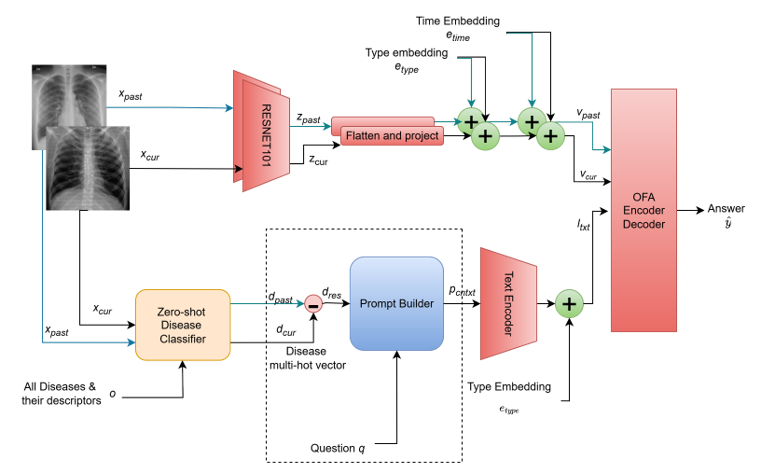
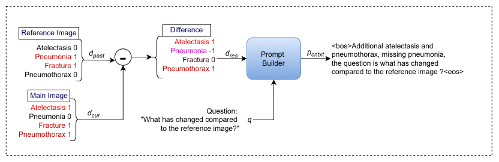
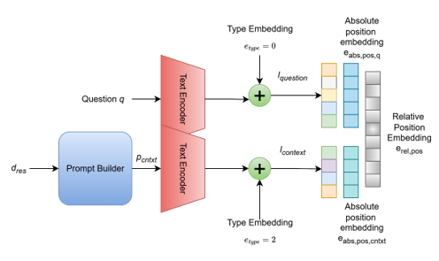
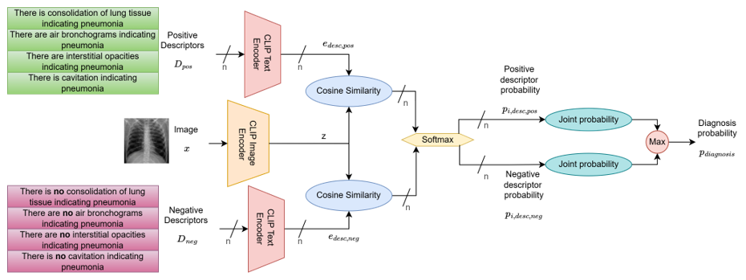
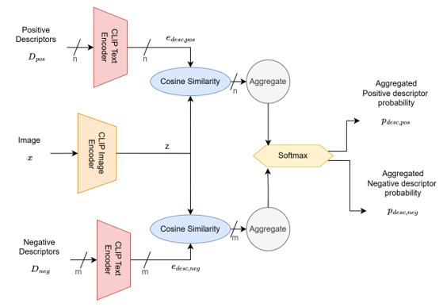
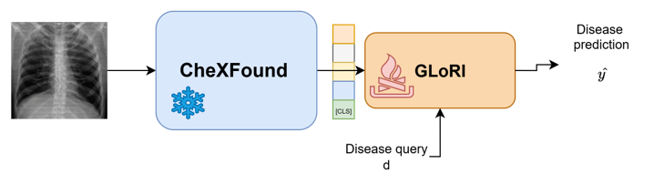
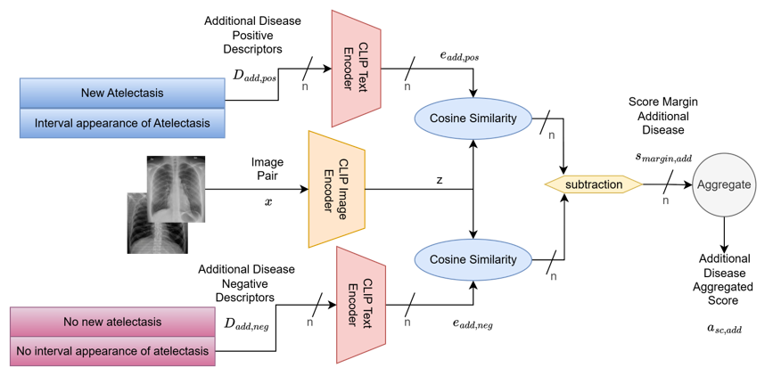
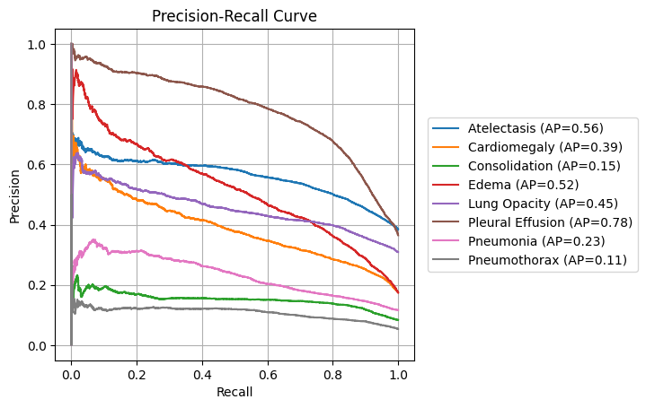
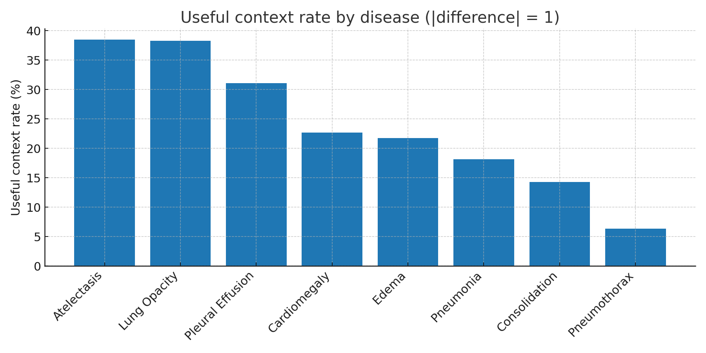
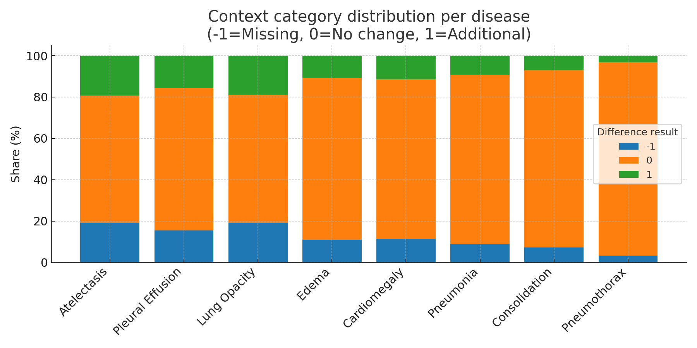

# Context-Aware Difference VQA for Chest X-rays

**Can a model describe what changed between two chest X-rays better if you first tell it which diseases appeared or disappeared?**


[](LICENSE)

M.Sc. thesis by Sebastian Sotela, Technical University of Munich (2025).
**Built on [PLURAL](https://github.com/yjch00/PLURAL)** ([Cho et al., MIDL 2024](https://arxiv.org/abs/2402.08966)). The base model and much of this code are the PLURAL authors' work. [What I added](#what-i-engineered) is listed below.

**My related repositories:** [Xplainer](https://github.com/sebtum/Xplainer) · [BioViL-T](https://github.com/sebtum/biovil-t) · [CheXFound](https://github.com/sebtum/CheXFound)

## TL;DR

- **Problem:** given a current and a prior chest X-ray, answer "what has changed?". The baseline model gets only the two images and the question.
- **What I built:** a pipeline that detects diseases in each image with zero-shot classifiers (no task-specific training), subtracts the two results, and feeds the difference to the model as a short text hint.
- **Key finding:** perfect hints raise CIDEr (a text-similarity score) from 1.832 to 5.656. My zero-shot hints reach 1.763, **slightly below the PLURAL baseline**. Hints help only if they are precise enough.

## Problem

Radiologists read a chest X-ray by comparing it with earlier ones. Difference visual question answering (Diff-VQA) automates that comparison. The thesis uses [MIMIC-Diff-VQA](https://physionet.org/content/medical-diff-vqa/1.0.0/): about 700,000 question-answer pairs over 164,324 image pairs.

| Challenge | Why it matters |
|---|---|
| Changes are small and sparse | A small effusion covers very few pixels |
| Severe class imbalance | Models lean toward frequent findings |
| No explicit clinical context | The model relies on image evidence alone |

## Approach



The upper path follows PLURAL. The lower path is the context branch I added: classifier, then difference, then prompt builder.

### Prompt builder



Each image gets a yes/no vector over 8 diseases: atelectasis, pleural effusion, lung opacity, edema, cardiomegaly, pneumonia, consolidation and pneumothorax. The residual is `current - prior`:

| Residual | Meaning | Word in the hint |
|---|---|---|
| +1 | new in the current image | `additional` |
| 0 | no change | nothing |
| -1 | gone in the current image | `missing` |

Example of the text the model receives:

```text
additional atelectasis and pneumothorax missing pneumonia the question is what has changed compared to the reference image?
```

### Two ways to inject the hint



| | Prepended | Separated context |
|---|---|---|
| Hint placement | before the question, joined by "the question is" | before the question, as its own segment |
| Type embedding | same as the question | its own (ID 2) |
| Absolute positions | shared with the question | its own table |
| Relative positions | shared | shared |
| Code | [`zero-shot-context`](https://github.com/sebtum/context-aware-diffvqa/tree/zero-shot-context) | [`separated_context`](https://github.com/sebtum/context-aware-diffvqa/tree/separated_context) |

Aggregate metrics differed negligibly. The thesis reports final numbers with separated context.

## Context sources compared

| Source | Input | How it decides | Code |
|---|---|---|---|
| [Xplainer](https://github.com/ChantalMP/Xplainer) (BioViL) | one image | similarity to text descriptors | [my fork](https://github.com/sebtum/Xplainer) |
| [CheXFound](https://arxiv.org/abs/2502.05142) | one image | disease-query classification head (GLoRI) | [my adaptation](https://github.com/sebtum/CheXFound) |
| [BioViL-T](https://arxiv.org/abs/2301.04558) | image pair | similarity to "new" and "resolved" descriptors | [my adaptation](https://github.com/sebtum/biovil-t) |

### Xplainer: default prompting vs. prototyping

**Default:** each descriptor gets a positive-vs-negative probability, then a joint probability per disease.



**Prototyping (my alternative):** average or max the raw similarities first, which drops the joint-probability assumption.



The default won on 5 of 8 diseases.

<details>
<summary>Average precision for all prompting strategies (thesis Table 5.3)</summary>

| Disease | Xplainer default | Diagnosis-name binary | "Evidence" + diagnosis binary | Prototype, ELIXR averaged | Prototype, ELIXR binary maxed | Prototype, ELIXR + diagnosis binary maxed | Prototype, prompt engineering |
|---|---|---|---|---|---|---|---|
| Atelectasis | **0.5601** | 0.3955 | 0.4706 | 0.4630 | 0.4704 | 0.4487 | 0.5438 |
| Cardiomegaly | 0.3885 | 0.3814 | 0.3791 | 0.3768 | **0.3895** | 0.3841 | 0.2965 |
| Consolidation | **0.1513** | 0.1291 | 0.0829 | 0.1032 | 0.1032 | 0.1190 | 0.0935 |
| Edema | **0.5185** | 0.4525 | 0.4858 | 0.4791 | 0.4600 | 0.4550 | 0.4127 |
| Lung Opacity | 0.4542 | **0.4871** | 0.3047 | 0.4679 | 0.4645 | 0.4688 | 0.3284 |
| Pleural Effusion | **0.7814** | 0.7666 | 0.5354 | 0.6985 | 0.6941 | 0.7351 | 0.6988 |
| Pneumonia | **0.2322** | 0.2241 | 0.1445 | 0.2217 | 0.2223 | 0.2174 | 0.1720 |
| Pneumothorax | 0.1083 | 0.1225 | 0.1140 | 0.1134 | 0.1134 | 0.1181 | **0.3172** |

[ELIXR](https://arxiv.org/abs/2308.01317) is the source of one of the descriptor sets.

</details>

### CheXFound: zero-shot vs. fine-tuned head



Fine-tuning trains only the GLoRI head (about 2 million parameters) with focal loss. The ViT-Large backbone stays frozen.

Average precision per disease (thesis Table 5.10):

| Disease | Xplainer, zero-shot | CheXFound, zero-shot | CheXFound, GLoRI fine-tuned |
|---|---|---|---|
| Atelectasis | 0.5601 | 0.3853 | **0.5807** |
| Cardiomegaly | **0.3885** | 0.1723 | 0.3651 |
| Consolidation | 0.1513 | 0.0836 | **0.1590** |
| Edema | **0.5185** | 0.1814 | **0.5185** |
| Lung opacity | 0.4542 | 0.3120 | **0.4598** |
| Pleural Effusion | **0.7814** | 0.3372 | 0.7517 |
| Pneumonia | **0.2322** | 0.1203 | 0.2161 |
| Pneumothorax | 0.1083 | 0.0564 | **0.2129** |

The final system stays zero-shot, so it uses Xplainer and not the fine-tuned head.

### BioViL-T: additional / missing classifier



For each disease it scores "additional" and "missing" separately. The two are exclusive, so a tie-break rule picks one (thesis Table 3.1):

| Additional score | Missing score | Hint |
|---|---|---|
| < 0 | < 0 | none |
| < 0 | >= 0 | missing |
| >= 0 | < 0 | additional |
| >= 0 | >= 0, not above the additional score | additional |
| >= 0 | >= 0, above the additional score | missing |

Average F0.5 (an F-score that favours precision) after sweeping per-disease thresholds (thesis Table 5.11):

| Disease | Average F0.5 |
|---|---|
| Atelectasis | 0.2374 |
| Cardiomegaly | 0.1624 |
| Consolidation | 0.1051 |
| Edema | 0.2037 |
| Lung opacity | 0.2375 |
| Pleural effusion | 0.2354 |
| Pneumonia | 0.1369 |
| Pneumothorax | 0.0423 |

No disease reached the 0.5 that the thesis treats as a usable hint.

## Results

Text-generation metrics (thesis Table 5.13):

| Metric | PLURAL baseline | **Mine: zero-shot hints** (Xplainer, precision-maximized) | DiffVQA-ReAl (literature) | Upper bound: perfect hints |
|---|---|---|---|---|
| BLEU-1 | 0.704 | 0.681 | 0.710 | 0.876 |
| BLEU-2 | 0.633 | 0.612 | 0.636 | 0.828 |
| BLEU-3 | 0.575 | 0.556 | 0.580 | 0.793 |
| BLEU-4 | 0.520 | 0.502 | 0.530 | 0.763 |
| METEOR | 0.381 | 0.372 | 0.395 | 0.524 |
| ROUGE-L | 0.653 | 0.642 | 0.736 | 0.876 |
| CIDEr | 1.832 | 1.763 | 2.409 | 5.656 |

- The upper bound uses hints built from ground-truth labels. It is not achievable in practice. It shows the generator can use accurate hints.
- My final system is slightly worse than the baseline. Limiting hints to pleural effusion alone did not help either.
- [DiffVQA-ReAl](https://doi.org/10.1007/978-3-031-72086-4_61) also uses larger images, a GPT-2 decoder and image augmentation.

### Operating points

I picked each disease's threshold by F0.5. Only three diseases were good enough to emit hints (thesis Table 5.12). All others were set to "not present".

| Disease | Threshold | Precision | Recall | F0.5 |
|---|---|---|---|---|
| Pleural Effusion | 0.650 | 0.792 | 0.586 | 0.740 |
| Atelectasis | 0.570 | 0.552 | 0.632 | 0.567 |
| Edema | 0.700 | 0.560 | 0.424 | 0.526 |



### How often is there anything useful to say?

A hint is useful only when a disease appears or disappears. No disease does so in more than 40% of cases.



<details>
<summary>Split into missing, no change and additional</summary>



</details>

## Key lessons

| Lesson | Detail |
|---|---|
| There is a precision floor | Below it, false hints pile up and cancel the gain from correct ones |
| Choose metrics for imbalance | AUROC misleads here. I used average precision and F0.5 |
| A "naive" assumption helped | Xplainer's joint probability acts like a soft AND and suppresses false positives. Pruning bad descriptors cost recall and lowered average precision |
| Check how rare the signal is | Under 40% of cases carry a useful hint for any of the 8 diseases |
| Measure what the model consumes | Precision should be measured on the final hint strings, not only on the disease classifier |

## Qualitative examples

Four pleural effusion cases (thesis Figures 5.5 to 5.8). The X-rays are not shown because MIMIC-CXR is credentialed data.

| Figure | What really changed | Hint given | Effect on the model | Hint was |
|---|---|---|---|---|
| 5.5 | no onset, no resolution | additional pleural effusion | pushed toward an increase that did not happen | misleading |
| 5.6 | no onset, no resolution | missing pleural effusion | implied a resolution that did not happen | misleading |
| 5.7 | effusion newly appeared | missing pleural effusion | nudged toward the opposite, a resolution | misleading |
| 5.8 | effusion newly appeared | additional pleural effusion | guided to the correct answer | helpful |

## What I engineered

### Context pipeline

| File | What it does |
|---|---|
| [`models/ofa/prompt_builder.py`](models/ofa/prompt_builder.py) | Turns two disease vectors into the hint and prepends it to the tokenized question |
| [`models/ofa/unify_transformer.py`](models/ofa/unify_transformer.py) | Runs the prompt builder inside the encoder. The [separated-context version](https://github.com/sebtum/context-aware-diffvqa/blob/separated_context/models/ofa/unify_transformer.py) adds type ID 2 and a context position table |
| [`data/mm_data/caption_dataset.py`](data/mm_data/caption_dataset.py) | Attaches disease vectors for the current and prior image, from Xplainer predictions or ground truth |
| [`tasks/ofa_task.py`](tasks/ofa_task.py) | Chooses what trains: OFA encoder layers and decoder, with the rest frozen |
| [`clean_inference.py`](clean_inference.py) | Runs test-set inference with logging, then computes the metrics |
| [`map_dicom_id_to_image_path.py`](map_dicom_id_to_image_path.py) | Maps image IDs to paths inside the MIMIC-CXR-JPG archive |
| [`create_xplainer_dataset.py`](create_xplainer_dataset.py) | Builds the image list and labels that the Xplainer fork reads |
| [`run_scripts/caption/`](run_scripts/caption/) | `train1_pretrain.sh` holds the training setup below; `overfit_*.sh` are small sanity runs |
| [`models/ofa/disease_classifier.py`](models/ofa/disease_classifier.py) | Early experiment with supervised disease, location and severity heads. **Not used** by the final pipeline |

### Making the baseline run and scale

| Area | Change |
|---|---|
| Multi-GPU | Patched fairseq's tensor broadcast ([`distributed/utils.py`](fairseq/fairseq/distributed/utils.py)) |
| Data streaming | [`data/file_dataset.py`](data/file_dataset.py): one GPU builds a cached line index, all GPUs then read rows on demand |
| Preprocessing | [`data_preprocess.py`](data_preprocess.py): multithreaded image encoding, chunked asynchronous writes, retries and logging |
| Evaluation | [`pycocoevalcap_custom/`](pycocoevalcap_custom/): added logging, plus Python substitutes for the Java tokenizer and METEOR. The committed `eval.py` runs the Java versions |

## Repository map

| Branch | Content |
|---|---|
| [`zero-shot-context`](https://github.com/sebtum/context-aware-diffvqa/tree/zero-shot-context) | Full thesis code, prepended hints (this page) |
| [`separated_context`](https://github.com/sebtum/context-aware-diffvqa/tree/separated_context) | Separated-context variant used for the final numbers |
| [`main`](https://github.com/sebtum/context-aware-diffvqa/tree/main) | PLURAL plus my reproduction fixes (preprocessing, data loading, multi-GPU, evaluation) |

| Related repository | My change |
|---|---|
| [Xplainer](https://github.com/sebtum/Xplainer) (fork) | MIMIC-Diff-VQA dataset, prototyping, diagnosis-only descriptors, embedding cache |
| [biovil-t](https://github.com/sebtum/biovil-t) | Additional / missing classification on image pairs |
| [CheXFound](https://github.com/sebtum/CheXFound) | MIMIC-Diff-VQA adaptation and GLoRI head fine-tuning |
| [CXR-RePaiR](https://github.com/sebtum/CXR-RePaiR) | Fix to dataset splitting and report section extraction |

## Reproduce

This is research code. Paths are hard-coded to the cluster used for the thesis, so edit them first. The steps below were read from the code and not re-run for this page.

**You need:** credentialed PhysioNet access to [MIMIC-CXR-JPG](https://physionet.org/content/mimic-cxr-jpg/2.0.0/) and [MIMIC-Diff-VQA](https://physionet.org/content/medical-diff-vqa/1.0.0/), 4 GPUs, Java (for the metrics), and the `PLURAL.pt` checkpoint linked in the [PLURAL README](docs/PLURAL_upstream.md).

### Environment

```bash
# The scripts expect the folder to be called PLURAL
git clone -b zero-shot-context https://github.com/sebtum/context-aware-diffvqa.git PLURAL
cd PLURAL
conda create -n plural python=3.7
conda activate plural
conda install pytorch==1.13.1 torchvision==0.14.1 torchaudio==0.13.1 pytorch-cuda=11.7 -c pytorch -c nvidia
pip install -r requirements.txt   # includes the bundled fairseq
pip install aiofiles psutil nltk  # also used by the scripts
```

### Pipeline

| Step | Command | Edit first |
|---|---|---|
| 1. Build TSV files | `python data_preprocess.py` | `tasks` and `splits` in `main()`; as committed it builds only the findings training set |
| 2. Provide disease labels | none | `compact_context_w_ref_id.csv` is required, and no script here creates it |
| 3. Prepare Xplainer input | `python map_dicom_id_to_image_path.py`, then `python create_xplainer_dataset.py` | input and output paths |
| 4. Predict diseases | run the [Xplainer fork](https://github.com/sebtum/Xplainer), then apply the thresholds above | prediction CSV path in `caption_dataset.py` and `clean_inference.py` |
| 5. Train | `IN_SERAPH=1 bash run_scripts/caption/train1_pretrain.sh` | `ws`, `data`, `restore_file` |
| 6. Evaluate | `IN_SERAPH=1 python clean_inference.py` | checkpoint and test file in `main()` |

For the upper bound with ground-truth hints, set `use_xplainer_results` to `False` in `caption_dataset.py` and `clean_inference.py`.

### Training configuration (thesis Table 5.14)

| Setting | Value |
|---|---|
| GPUs | 4 |
| Per-GPU batch size | 8 |
| Update frequency | 8 (effective batch 256) |
| Max epochs | 5 |
| Optimizer | Adam |
| Initial learning rate | 1.35e-4 |
| LR schedule | polynomial decay with warm-up |
| Warm-up ratio | 0.06 |
| Gradient clip norm | 5 |
| Drop-worst | disabled |
| Decoding | beam search, beam size 5 |
| Context fusion | separated (reported) |
| Frozen modules | external text and image encoders |
| Trainable modules | OFA encoder and decoder |

Two details of the committed code: `train1_pretrain.sh` delays drop-worst to 200,000 updates, which a 5-epoch run does not reach; `clean_inference.py` passes `--beam=10`, not 5.

## Credits

| Work | Role here |
|---|---|
| [PLURAL](https://github.com/yjch00/PLURAL), Cho et al. | Base model and code. Original README: [`docs/PLURAL_upstream.md`](docs/PLURAL_upstream.md) |
| [OFA](https://github.com/OFA-Sys/OFA) | Multimodal encoder-decoder |
| [fairseq](https://github.com/facebookresearch/fairseq) | Training framework |
| [Xplainer](https://github.com/ChantalMP/Xplainer), Pellegrini et al. | Zero-shot disease classifier |
| [BioViL-T](https://arxiv.org/abs/2301.04558), Bannur et al. | Temporal vision-language model |
| [CheXFound](https://arxiv.org/abs/2502.05142), Yang et al. | Chest X-ray foundation model |
| [pycocoevalcap](https://github.com/salaniz/pycocoevalcap) | Caption metrics |

Thesis at the TUM Department of Informatics. Examiner: Nassir Navab. Supervisor: Hong Joo Lee.

## Citation

```bibtex
@mastersthesis{sotela2025contextaware,
  author = {Sotela, Sebastian},
  title  = {Context-Aware Different Visual Question Answering for Chest X-ray Images},
  school = {Technical University of Munich},
  year   = {2025}
}

@inproceedings{cho2024plural,
  author    = {Cho, Y. and Kim, T. and Shin, H. and Cho, S. and Shin, D.},
  title     = {Pretraining Vision-Language Model for Difference Visual Question Answering in Longitudinal Chest X-rays},
  booktitle = {Proceedings of the 7th Conference on Medical Imaging with Deep Learning},
  series    = {Proceedings of Machine Learning Research},
  volume    = {250},
  pages     = {263--275},
  year      = {2024}
}
```

## License

[Apache-2.0](LICENSE), inherited from PLURAL.
